# Somatem workflow steps and tools

Somatem exposes seven analysis commands and two data-preparation commands. The sections below trace their steps, tools, conditional branches, and output dependencies, followed by the shared workflow helpers and developer test workflows.

This describes the local source at commit `397e87c`, inspected on October 13, 2026. It is a static source trace, not a record of executed pipelines. REA's source-repository route was used: the complete Nextflow source and local scripts provide the evidence, so no binary analysis or REA provider session was needed. External tools are traced to their local invocation boundary; their internal algorithms are not inferred from package names.

In the Mermaid diagrams, arrows show data or control dependencies rather than a mandatory serial schedule. Branches may run concurrently. Tool names appear in processing nodes; Nextflow labels identify routing, joins, and collection. An output being emitted does not necessarily mean it is published outside the Nextflow work directory. Defaults refer to the checked-in configuration and may be overridden.

| Command | Nextflow route | Shared preprocessing | Main tools |
|---|---|---|---|
| [`pre_processing`](#preprocessing) | `PREPROCESSING` | This is the preprocessing route | NanoPlot, optional Deacon, Chopper |
| [`16S`](#16s-profiling) | `TAXONOMIC_PROFILING`, 16S branch | Yes | Emu, Taxburst |
| [`taxonomic_profiling`](#metagenomic-taxonomic-profiling) | `TAXONOMIC_PROFILING`, metagenomic branch | Yes | Sylph, LEMUR/MAGNET, Kraken2, or SingleM |
| [`assembly_mags`](#assembly-and-mag-recovery) | `ASSEMBLY_MAGS` | Yes | Flye, AGB, minimap2, samtools, binning tools, Pigeon, CheckM2, SingleM, Bakta |
| [`isolate_analysis`](#isolate-analysis) | `ISOLATE_ANALYSIS` | No | Autocycler, Flye, Kraken2, optional polishing, CheckM2, MOB-suite, Bakta, optional BTyper3 |
| [`seqscreen`](#seqscreen) | `SEQSCREEN_DSL2` | No | SeqScreen modules, aligners, classifiers, Python reporting |
| [`genome_dynamics`](#genome-dynamics) | `GENOME_DYNAMICS` | Yes | Rhea, Bandage |
| [`pre_download_databases`](#database-preparation) | Standalone entry → `DOWNLOAD_DBS` | No | Database-specific download tools |
| [`download_example_data`](#example-data-download) / `examples` | Standalone download entry | No | Python standard library, fallback gdown |

Sources: [launcher](../bin/somatem), [main entry](../main.nf), [dispatcher](../workflows/somatem.nf), [configuration](../nextflow.config).

## Shared launch and orchestration

| Step | Tool | Behavior |
|---|---|---|
| 1 | Bash launcher, `bin/somatem` | Resolve installation/cache locations, normalize CLI aliases and arguments, and choose the entry file. For main analysis commands, check Nextflow is at least 26.04.6. |
| 2 | Bash launcher | For supported analysis shortcuts lacking explicit input/parameter files, select the corresponding example samplesheet from the override, remembered download location, or installation assets. `pre_processing` does not use this shortcut. |
| 3 | Nextflow configuration and execution profiles | Load workflow defaults, module arguments, resource settings, and the selected environment profile. The standard profile enables Conda environments through micromamba. |
| 4 | `PIPELINE_INITIALISATION`, Nextflow/Groovy helpers | Handle version-only exit, save parameters, inspect configuration/profile usage, optionally check Conda channels, and validate the selected genome key. The imported schema-wide `validateParameters` function is not called here. |
| 5 | nf-schema or Nextflow CSV parser | Generic reads use `samplesheetToList` and the input schema. Isolate and SeqScreen use their own CSV validation/path checks. All routes produce metadata/file tuples and count samples. |
| 6 | `ORCHESTRATE_SOMATEM` → `SOMATEM`, Nextflow | Resolve required database channels except for SeqScreen, which requires an existing database directory. Apply shared preprocessing except to isolate analysis and SeqScreen. Dispatch the selected analysis. |
| 7 | `SOMATEM_SUMMARY_REPORT`, Python `somatem_report.py` | Where wired, collect a workflow's report inputs across samples and produce its HTML summary under `summary_reports/`. SeqScreen has its own reporting chain. |
| 8 | nf-core YAML helper + Nextflow `collectFile` | Collate the versions actually mixed into the workflow's version channel as `pipeline_info/somatem_software_versions.yml`. Some modules emit topic-channel versions that are not collected here. |
| 9 | Nextflow reporting and completion hooks | Produce configured execution report, timeline, trace and DAG; print completion/error status; copy `.nextflow.log` to a timestamped path under `pipeline_info/`. The local completion workflow does not call the available email/notification helpers. |

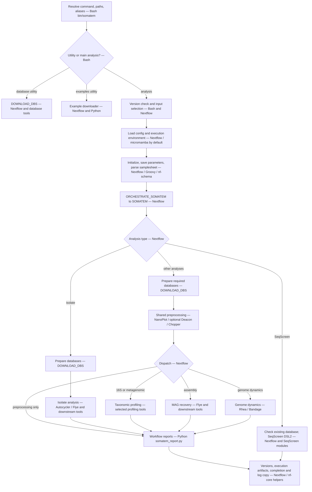

Database acquisition and independent read tasks can overlap; the overview groups those operations for readability. Their precise data dependencies appear in the individual sections. Sources: [initialization/completion](../subworkflows/local/utils_nfcore_somatem_pipeline/main.nf), [Nextflow helpers](../subworkflows/nf-core/utils_nextflow_pipeline/main.nf), [nf-core helpers](../subworkflows/nf-core/utils_nfcore_pipeline/main.nf), [summary module](../modules/local/somatem_summary_report/main.nf).

## Preprocessing

Entry: `somatem pre_processing` selects `analysis_type=pre-processing`. This runs the shared `PREPROCESSING` subworkflow and stops before any downstream analysis. Defaults are metagenomic data, `sample_environment=human_gut`, minimum quality 10, and minimum length 250; therefore host depletion is enabled with the default settings. `run_deacon` is computed from a human/mouse environment and non-16S data. Sources: [CLI](../bin/somatem), [orchestrator](../workflows/somatem.nf), [preprocessing](../subworkflows/local/pre-processing.nf), [defaults](../nextflow.config), [module arguments](../conf/modules.config).

| Step | Tool / implementation | Behavior and result |
|---|---|---|
| 1 | Nextflow initialization | Validate/parse the samplesheet into metadata/read tuples; enter `PREPROCESSING`. |
| 2, optional | Nextflow path lookup; **Deacon** (`DEACON_FETCH`) | When host depletion is enabled, reuse an existing supplied index path or fetch the human/mouse minimizer index. |
| 3, independent QC branch | **NanoPlot** (`RawNanoPlot`) | Read the original input and produce HTML, text statistics, logs, and optional PNGs. This does not gate the filtering branch. |
| 4, optional | **Deacon** (`DEACON_FILTER`) | Deplete reads matching the host index; output compressed clean FASTQ and a JSON summary. Otherwise pass original reads onward. |
| 5 | **zcat → Chopper → gzip** (`CHOPPER`) | Decompress, filter by configured quality/minimum length, and recompress to `<sample>.fastq.gz`. The orchestrator supplies an empty contaminant reference, so Chopper's additional reference-based removal is inactive. |
| 6 | **NanoPlot** (`FinalNanoPlot`) | Generate post-filtering QC. Configuration adds a two-second shell delay, one concurrent final-QC task, and scratch execution. |
| 7 | **Python**, `somatem_report.py` (`PREPROCESSING_SUMMARY_REPORT`) | Collect raw/final NanoStats, filtered FASTQ, optional Deacon outputs, software versions, and the original samplesheet into `pre_processing_summary_report.html`. |
| 8 | Nextflow/nf-core version collation | Emit clean reads, the summary, and versions; the top-level pipeline writes `pipeline_info/somatem_software_versions.yml` and completion records. |

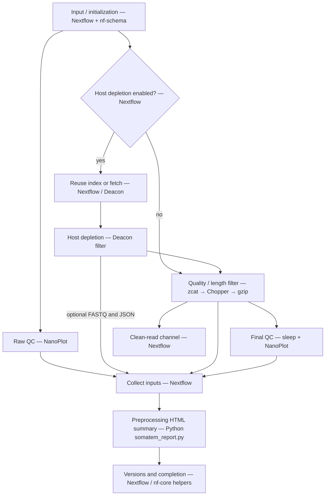

The configured maximum length of 30,000 is passed to NanoPlot; Chopper receives only minimum quality and minimum length. It is therefore not a maximum read-length filtering step. The NanoPlot wrapper explicitly recognizes `.fastq.gz`, `.fq.gz`, and sequencing-summary `.txt` input names. Sources: [NanoPlot wrapper](../modules/nf-core/nanoplot/main.nf), [Deacon filter](../modules/local/deacon/filter/main.nf), [Deacon index fetch](../modules/local/deacon/fetch/main.nf), [Chopper wrapper](../modules/nf-core/chopper/main.nf), [summary module](../modules/local/somatem_summary_report/main.nf).

## 16S profiling

Entry: `somatem 16S` sets `data_type=16S` and `analysis_type=taxonomic-profiling`. This is the 16S branch of `TAXONOMIC_PROFILING`, rather than a separate Nextflow subworkflow. Default host depletion is off. The metagenomic `taxonomic_profiler` selector does not choose the tool in this branch: it uses Emu. Sources: [CLI](../bin/somatem), [taxonomy workflow](../subworkflows/local/taxonomic-profiling.nf), [database workflow](../subworkflows/local/download_databases.nf).

| Step | Tool / implementation | Behavior and result |
|---|---|---|
| 1 | Nextflow initialization | Resolve the 16S samplesheet and read tuples. |
| 2 | **OSF client** (`EMU_DOWNLOAD_DB`), shell `mkdir`/`mv` (`EMU_STAGE_DB`) | Obtain `species_taxid.fasta` and `taxonomy.tsv` using the configured persistent database directory, then stage an `emu_db` directory. |
| 3 | **NanoPlot** (`RawNanoPlot`) | Original-read QC, independent of read filtering. |
| 4 | **zcat → Chopper → gzip** | Quality/length-filter reads. An explicitly enabled Deacon branch is inherited from shared preprocessing; it is disabled by the 16S defaults. |
| 5 | **NanoPlot** (`FinalNanoPlot`) and **Python** `somatem_report.py` | Final QC and the common preprocessing summary; profiling can begin when filtered reads are ready. |
| 6 | **Emu** (`EMU_ABUNDANCE`) | Run abundance estimation on clean reads with `params.emu_db`. Emit abundance TSV; optional assignment TSV, SAM, and unclassified FASTA outputs depend on configured Emu flags. Defaults keep counts/read assignments and request unclassified outputs, while `keep_files` is false. |
| 7 | **Python**, `taxburst_prep.py` (`TAXBURST_CONVERT`) | Convert Emu abundance into Krona-format TSV. Skip Emu unmapped/unclassified tax-ID rows, normalize missing taxonomy ranks, and adjust the duplicated Actinobacteria class label. |
| 8 | **Taxburst** (`TAXBURST`) | Produce interactive taxonomy HTML; JSON is optional. “Krona” here names the input format, not a separate Krona executable. |
| 9 | **Python**, `somatem_report.py` (`TAXONOMY_SUMMARY_REPORT`) | Combine abundance tables, visualization, versions, and samplesheet into `16S_summary_report.html`. |
| 10 | Nextflow/nf-core helpers | Emit taxonomy results and summaries; collate versions and finish the run. |

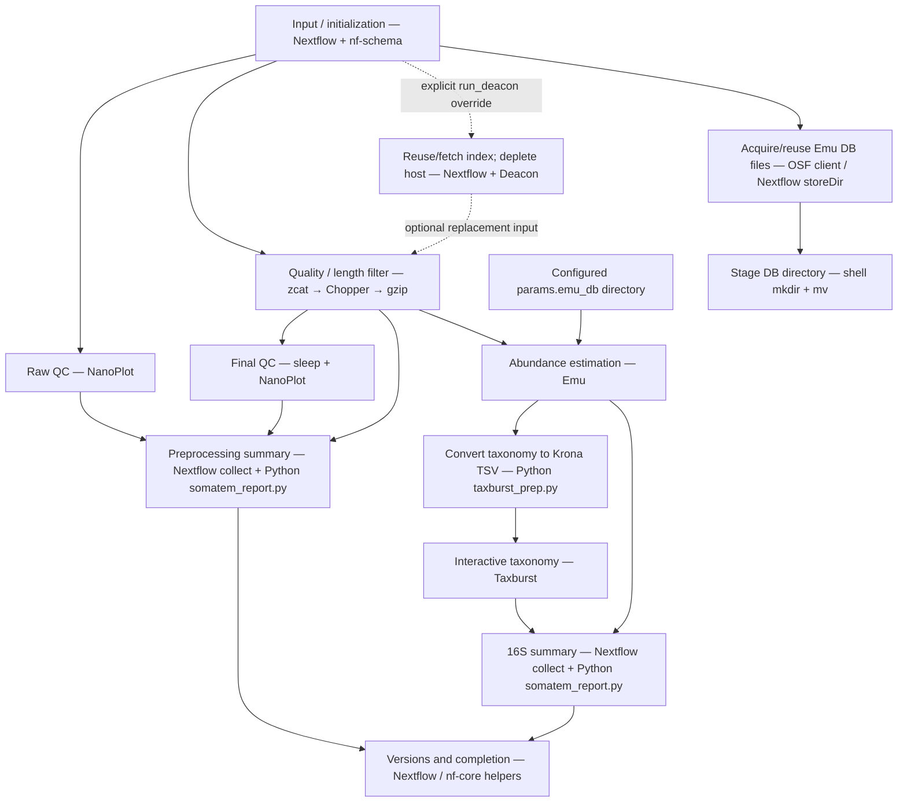

**Observed wiring limitation:** `EMU_STAGE_DB` emits a database channel, but the top-level pipeline does not pass it to `EMU_ABUNDANCE`; Emu reads `params.emu_db` through configuration. Consequently, the source does not establish a channel dependency that makes Emu wait for the database download/staging task. The diagram preserves that missing edge rather than implying synchronization. Emu can use an already-populated configured directory. The conversion process emits versions, but the 16S branch does not mix those conversion versions into its version channel. Sources: [Emu database modules](../modules/local/emu/download_db/main.nf), [Emu wrapper](../modules/local/emu/main.nf), [conversion wrapper](../modules/local/taxburst_convert/main.nf), [converter](../bin/taxburst_prep.py), [Taxburst wrapper](../modules/local/taxburst/main.nf), [module configuration](../conf/modules.config).

## Metagenomic taxonomic profiling

Entry: `somatem taxonomic_profiling` (alias `tax`) selects metagenomic data unless a data type is explicitly supplied. `--data_type 16S` follows the 16S workflow above. For metagenomic data, exactly one profiler branch is selected: **Sylph (default)**, **LEMUR → MAGNET**, **Kraken2**, or **SingleM**. These are alternatives, not an ensemble. Sources: [CLI](../bin/somatem), [taxonomy workflow](../subworkflows/local/taxonomic-profiling.nf), [defaults](../nextflow.config).

| Step | Tool / implementation | Behavior and result |
|---|---|---|
| 1 | Nextflow initialization | Parse the input samplesheet and choose the data-type/profiler branch. |
| 2 | Nextflow + **Deacon**, **NanoPlot**, **Chopper**, **gzip**, **Python** | Run the complete shared preprocessing path: optional host-index reuse/fetch and depletion; independent raw QC; quality/length filtering; final QC; preprocessing HTML summary. |
| 3a, Sylph only | Nextflow path checks; **aria2c** (`SYLPH_DOWNLOAD_DB`) | Reuse the selected `.syldb`; otherwise download a supported standard database. Missing explicitly supplied databases and missing `all` databases fail instead of being downloaded. The default group is prokaryotic. |
| 3b, LEMUR only | Groovy/Java HTTPS + JSON parsing; **aria2c**, **tar**, **mv** (`LEMUR_DATABASEDOWNLOAD`); shell staging (`LEMUR_STAGE_DB`) | Resolve Zenodo metadata/checksum, obtain/extract the selected database, and stage its reference and taxonomy files. Stored database outputs can be reused. |
| 3c, Kraken2 only | Nextflow path check, or **aria2c**, **tar**, shell (`KRAKEN2_TAXONOMY_DOWNLOAD_DB`) | Use a supplied existing database or acquire/extract the configured Standard-8 database. |
| 3d, SingleM only | **SingleM data** (`SINGLEM_TAXONOMY_DOWNLOAD_DB`) | Acquire/reuse the metapackage and verify the expected directory exists. |
| 4a, Sylph only | **Sylph profile** (`SYLPH_PROFILE`) | Profile clean reads against the selected database; produce a TSV. |
| 5a, Sylph only | **sylph-tax download → sylph-tax taxprof → Python taxburst_prep.py** (`TAXBURST_CONVERT`) | Acquire taxonomy mapping, expand the Sylph profile into taxonomy, and convert leaf clades into Krona-format TSV. The taxonomy download is inside each conversion task, separate from `.syldb` acquisition. |
| 6a, Sylph only | **Taxburst** | Produce interactive taxonomy HTML. |
| 4b, LEMUR only | **LEMUR** | Generate `relative_abundance.tsv`, using species rank by default. |
| 5b, LEMUR only | **MAGNET**, alongside **Python taxburst_prep.py → Taxburst** | MAGNET receives clean reads and LEMUR classifications and emits `*cluster_representative.csv`. Independently, the visualization branch converts and plots the LEMUR report. MAGNET's report is mixed with the LEMUR report; Taxburst is not rerun on MAGNET output. |
| 4c, Kraken2 only | **Kraken2**, optional **pigz** | Classify reads and emit report text. Read assignments are saved by default. Classified/unclassified FASTQ saving is off by default; when enabled, pigz compresses them. No Taxburst conversion is wired here. |
| 4d, SingleM only | **SingleM pipe** | Profile reads. With repository defaults, emit taxonomic-profile TSV and OTU-table CSV. Krona HTML, archive OTUs, and jplace outputs are optional module capabilities; no config enables them by default. The workflow consumes profile TSV and any optional Krona HTML. |
| 7 | **Python**, `somatem_report.py` (`TAXONOMY_SUMMARY_REPORT`) | Collect the selected branch's reports, available visualizations, versions, and samplesheet into `taxonomic_profiling_summary_report.html`. |
| 8 | Nextflow/nf-core helpers | Emit selected taxonomy reports and summaries; collate versions and finish the run. |

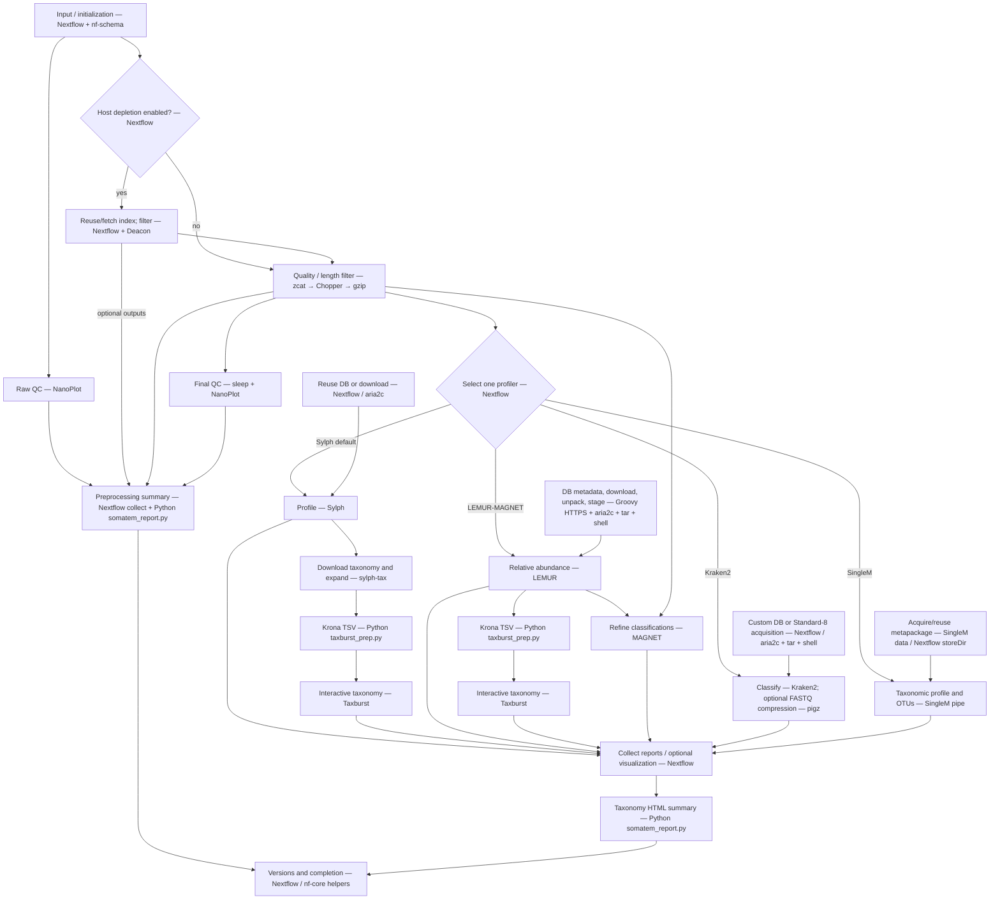

**Observed association limitation:** the LEMUR branch removes sample metadata from the classification-report channel before invoking MAGNET with reads and classifications as two separate queue inputs. There is no explicit sample-ID join, so matching reports to reads across multiple concurrently completed samples is not guaranteed by this wiring. This is a static code finding, not an observed failed run. The LEMUR branch also omits `TAXBURST_CONVERT` versions from its collected versions, while the Sylph branch includes them.

Sources: [database dispatch](../subworkflows/local/download_databases.nf), [Sylph download](../modules/local/sylph/download_db/main.nf), [LEMUR download/staging](../modules/local/lemur/download_db/main.nf), [Kraken2 download](../modules/local/kraken2/download_db/main.nf), [SingleM download](../modules/local/singlem/download_db/main.nf), [Sylph profile](../modules/nf-core/sylph/profile/main.nf), [LEMUR](../modules/local/lemur/main.nf), [MAGNET](../modules/local/magnet/main.nf), [Kraken2](../modules/nf-core/kraken2/kraken2/main.nf), [SingleM](../modules/local/singlem/pipe/main.nf), [taxonomy conversion](../modules/local/taxburst_convert/main.nf), [Taxburst](../modules/local/taxburst/main.nf).

## Assembly and MAG recovery

Entry: `somatem assembly_mags` (alias `mag`), selecting `analysis_type=assembly`. [SOMATEM](../workflows/somatem.nf) calls [ASSEMBLY_MAGS](../subworkflows/local/assembly_mags.nf) with **cleaned reads**. The local comment calling these “raw reads” does not reflect the caller. First, the shared launch path parses the samplesheet, [preprocessing](#preprocessing) runs NanoPlot, optional Deacon, Chopper and final NanoPlot, and [database preparation](#database-preparation) supplies CheckM2, Bakta and the SingleM metapackage. The table expands the analysis that follows.

The default route uses Flye, iterative binning with three binners, Pigeon candidate selection, DAS Tool consensus, CheckM2 assessment and completeness-gated Bakta annotation. Defaults come from [nextflow.config](../nextflow.config) and [module configuration](../conf/modules.config).

| Step | Process and actual tool | Input → action → output |
|---|---|---|
| A1 | `SINGLEM_PIPE` — [SingleM `pipe`](../modules/local/singlem/pipe/main.nf) | Cleaned reads + metapackage → marker-based profiling → taxonomic profile TSV and reads OTU CSV. Configured minimum ORF length is 96. Runs alongside assembly. |
| A2 | `TAXBURST` — [TaxBurst](../modules/local/taxburst/main.nf) | SingleM profile → interactive taxonomic HTML, using the `SingleM` input format. |
| A3 | `FLYE` — [Flye + gzip](../modules/nf-core/flye/main.nf) | Cleaned reads → metagenome assembly, with `nano-hq` mode by default → compressed contig FASTA, GFA, Graphviz graph, assembly information, log and parameters JSON. `--meta` is always supplied. |
| A4 | `AGB` — [Python wrapper](../bin/run_agb.py) + AGB `agb.py` | Join GFA, Graphviz graph and information by metadata → decompress/copy inputs, make a task-local AGB package copy, patch its legacy `os.io.open` reference, invoke AGB → validated nonempty `agb_output/viewer.html`. |
| A5 | `MINIMAP2_INDEX` — [minimap2](../modules/nf-core/minimap2/index/main.nf) | Assembly FASTA → `.mmi` index. |
| A6 | `MINIMAP2_ALIGN` — [minimap2 + samtools sort](../modules/nf-core/minimap2/align/main.nf) | Reads + index → SAM streamed to samtools → sorted BAM and BAI. The module already sorts here. |
| A7 | `SAMTOOLS_SORT` — [samtools cat + sort](../modules/nf-core/samtools/sort/main.nf) | Aligned BAM + reference → another sorted BAM and BAI, with `_sorted` prefix. |
| A8 | `SAMTOOLS_COVERAGE` — [samtools coverage](../modules/nf-core/samtools/coverage/main.nf) | Sorted BAM + assembly → coverage text, with `-m`. This is a reporting side branch; its output is not the input to the binners. |
| A9a | `PIGEON_ITERATIVE_BINNING` — [Python orchestration](../modules/local/pigeon/iterate/main.nf) | **Default:** joined GFA + assembly + sorted BAM → bounded SemiBin2/MetaBAT2/VAMB candidate loop, Pigeon scoring, selection and optional DAS Tool consensus. Detailed steps below. |
| A9b | `SEMIBIN_SINGLEEASYBIN` — [SemiBin2](../modules/nf-core/semibin/singleeasybin/main.nf) | **When iterative binning is disabled:** assembly + BAM → one `single_easy_bin` run → compressed bin FASTAs, CSV/TSV tables and optional model. Configured for long reads and `human_gut` pretrained model; an empty environment selects self-supervised training. |
| A10 | Nextflow channel selection | Iterative + `dastool` → direct DAS Tool bins; iterative + `none` → materialized selected bins; noniterative → SemiBin2 bins. This common bin channel feeds all remaining analyses. |
| A11 | `CHECKM2_PREDICT` — [CheckM2](../modules/nf-core/checkm2/predict/main.nf) | Bins + database → completeness/contamination quality report TSV and CheckM2 output directory. |
| A12 | `CHECKM2_PARSE` — [Python/pandas parser](../bin/parse_checkm2.py) | CheckM2 report → bin-name/completeness CSV. |
| A13 | `SINGLEM_PIPE_BINS` — [SingleM `pipe`](../modules/local/singlem/pipe/main.nf) | All selected bins + metapackage → genome OTU CSV; minimum ORF length 300. This branch does not wait for CheckM2 or filter bins by completeness. |
| A14 | `SINGLEM_APPRAISE` — [SingleM `appraise`](../modules/local/singlem/appraise/main.nf) | Match reads and bins OTU tables by sample → compare recovered bins with read-level diversity → summary text, binned/unbinned OTU CSVs and SVG plot. Uses imperfect matching with sequence identity 0.95. No assembly OTU input is supplied; assembled/unaccounted outputs are optional and not enabled by default. |
| A15 | `PIGEON` — [pigeon.py](../bin/pigeon.py), gfatools, sourmash, Python/Plotly | Assembly GFA + contigs + final bins → independent post-hoc comparison → sample-prefixed HTML and metrics JSON. Internals are below. |
| A16 | Nextflow metadata join and filter | Split bins individually; retain sample identity; join CheckM2 completeness by sample and bin name → keep only bins with known completeness ≥80% by default. No contamination threshold is applied here. |
| A17 | `BAKTA_BAKTA` — [Bakta + bakta_plot](../modules/local/bakta/bakta/main.nf) | Retained bins + Bakta database → input checks, annotation, plots → EMBL/GenBank/GFF3, nucleotide/protein FASTAs, annotation/inference TSVs, JSON/text and PNG/SVG. Missing expected outputs can be replaced with empty placeholder files. |
| A18 | `ASSEMBLY_MAGS_SUMMARY_REPORT` — [Python somatem_report.py wrapper](../modules/local/somatem_summary_report/main.nf) | Collect samplesheet, assembly info/logs, graph, coverage, binning/selection reports, CheckM2, SingleM/TaxBurst, Pigeon, appraisal, Bakta tables/JSON/PNG and software versions across samples → `assembly_mags_summary_report.html`. |

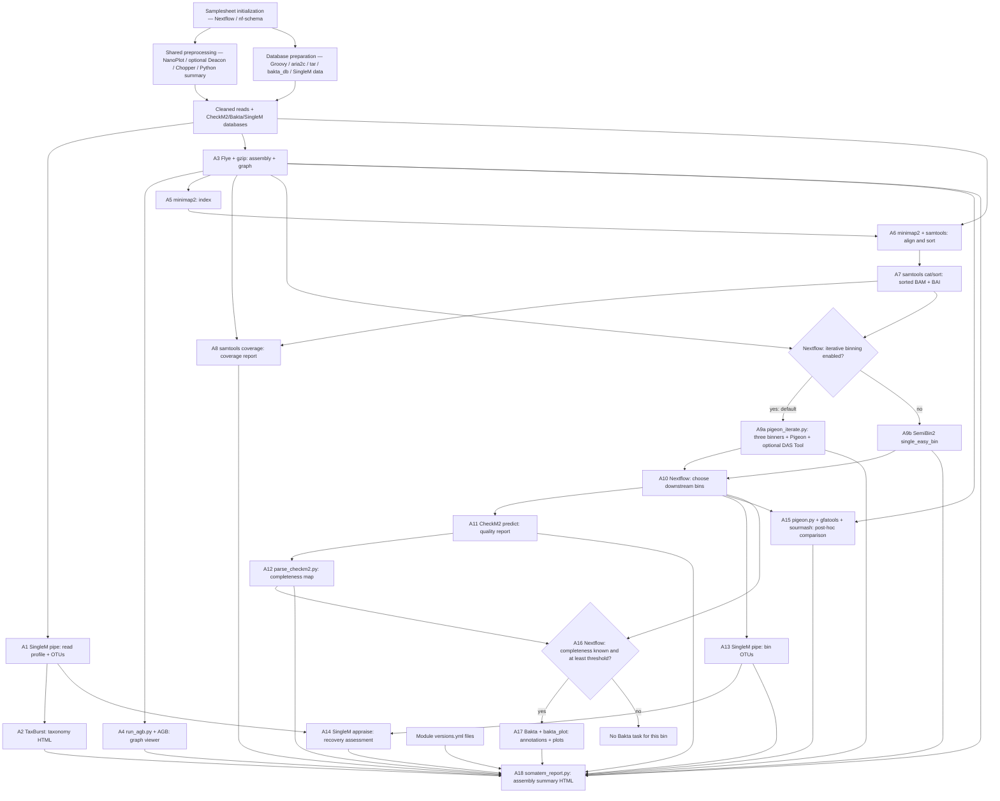

### Inside iterative binning

Source: [pigeon_iterate.py](../bin/pigeon_iterate.py). All these operations run inside **one Nextflow task per sample**. The Python loops execute the binners sequentially, not as three independent Nextflow processes.

| Step | Tool | Behavior |
|---|---|---|
| I1 | Python | Validate input paths, threads, iteration/seed settings and binner names; initialize command log, per-binner targets, scores and active state. Configured maximum is five iterations and the script clamps larger values to five. |
| I2 | Python | For each iteration, choose each active binner in order: SemiBin2, MetaBAT2, VAMB. Default seeds start at 42 and increase by one each iteration. |
| I3a | SemiBin2 `single_easy_bin` | Current target FASTA + original BAM → candidate bins; use selected environment or self-supervised training. |
| I3b | `jgi_summarize_bam_contig_depths` → MetaBAT2 | Original BAM → depth table; current target FASTA + depth → candidate bins. The depth calculation occurs for every MetaBAT2 iteration. |
| I3c | VAMB `bin default` | Stage BAM link/copy → current FASTA + BAM directory → candidate bins; minimum FASTA size setting is 200,000. |
| I4 | Python + pigeon.py | Failed binner command or no bin FASTAs stops that binner. Successful candidates are scored by Pigeon against the original complete GFA and assembly. Candidate Pigeon calls always skip RocksDB. Pigeon failures are not caught by the binner-error handler. |
| I5 | Python exact canonical k-mer comparison | Optional residual rebinning, disabled by default: write poorly explained contigs as the next target, using configured length and unexplained-fraction filters. VAMB is stopped before a residual target is used because it would no longer match the original BAM reference set. |
| I6 | Python | Default optimization score is `1 - pigeon_loss`. Update per-binner gain/plateau state; stop after two insufficient gains by default, residual exhaustion, maximum iterations, or a supplied `stop_candidate` decision. The current pigeon.py does not emit that decision, so that last branch is a dormant extension point. Default runs change seeds on the complete assembly because residual rebinning is off. |
| I7 | Python | Write candidate manifest; choose highest-scoring iteration independently for each binner, breaking ties by bin-explained fraction then earlier iteration; materialize selected-bin links and write selection/trajectory TSVs and selection JSON. This selection uses graph/sketch metrics, before CheckM2. |
| I8a | Python → DAS Tool with DIAMOND search engine | Default consensus path: decompress/normalize selected bins, create contig-to-bin tables, decompress assembly if necessary, invoke DAS Tool to write consensus bins, then materialize `final_bins` links. No selected candidates is an error. |
| I8b | Python | If consensus is `none`, combine the selected binner outputs in `final_bins` with binner-derived filename prefixes. This is a combined collection, not deduplicated consensus. |
| I9 | Python + optional Plotly | Write iterative summary JSON and HTML report, convergence information and command log. Nextflow emits both final bins and optional direct DAS Tool bins; the workflow chooses the latter under default consensus. |

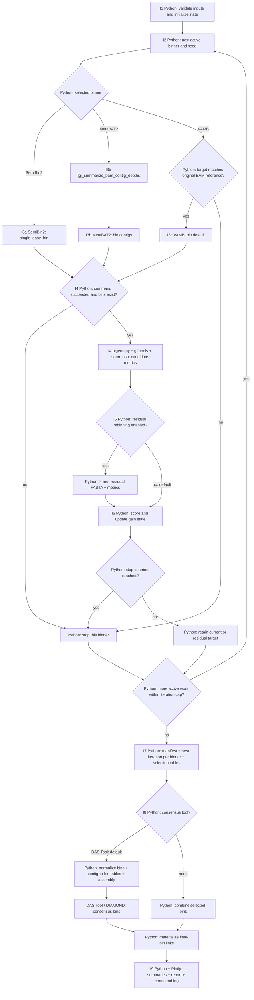

### Inside each Pigeon analysis

Both candidate scoring and final post-hoc analysis use [pigeon.py](../bin/pigeon.py). It sketches the assembly with sourmash `scripts singlesketch`; extracts graph unitigs with gfatools `asm -u` and, when needed, `gfa2fa`; sketches those unitigs; and sketches all bin FASTAs with sourmash `sketch dna`. Python loads MinHash sets, optionally stores union sets in RocksDB, calculates unitig recovery/overlap, cumulative bin coverage, PAM and adaptive Pigeon loss, and writes metrics JSON, loss-profile TSV and a Plotly HTML report. Configured sketch defaults are k=17, scaled=1000 and seed=42. Candidate calls disable RocksDB; the final pass permits it if installed. Nextflow publishes the final pass's prefixed HTML/JSON, not every internal file.

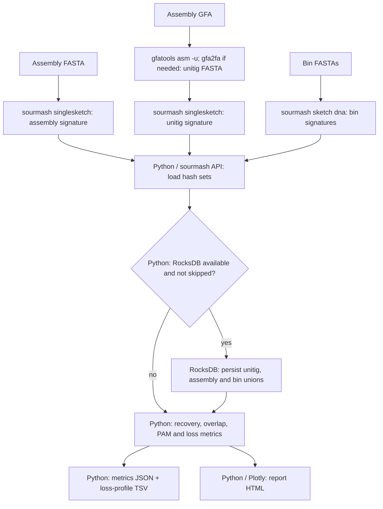

Published result families include `binning/iterative/` or `binning/semibin2/`, `mapping/`, `quality/`, `annotation/`, `pigeon/`, `taxonomic_profiling/`, `assembly_mags/` and `summary_reports/` under the configured output directory. Exact paths are defined by each module, and workflow-emitted artifacts are not always copied by its publication patterns.

Source-visible limitations to preserve when reading this diagram:

- [Flye](../modules/nf-core/flye/main.nf) emits `.fasta.gz` and `.gfa.gz`, while its publication patterns match `.fasta` and `.gfa`. Their downstream channel use is clear; copying the compressed artifacts to the published assembly directory is not established by those patterns.
- [Bakta's preflight](../modules/local/bakta/bakta/main.nf) searches for FASTA headers directly with `grep`, without gzip decompression. Plain SemiBin2 emits compressed bins, so that alternative route has an apparent input-compatibility issue. Missing Bakta artifacts may also be empty placeholders, so file existence alone does not demonstrate successful annotation or plotting.
- [Pigeon configuration](../conf/modules.config) passes `--skip_db` when `pigeon_skip_db` is enabled, whereas [pigeon.py](../bin/pigeon.py) accepts `--skip-db`. The default false value avoids that option mismatch.
- Iterative SemiBin2 does not receive the `--sequencing-type long_reads` argument configured for the standalone SemiBin2 process. These are different invocations despite using the same binner.
- Several alignment/quality module calls consume separate queue channels without explicitly joining sample identities. The assembly-to-binning and graph-artifact joins are explicit; correct per-sample pairing at every other call was not runtime-validated.

## Isolate analysis

`somatem isolate_analysis` (alias `isolate`) selects `analysis_type=isolate-analysis`. This route accepts long reads plus optional paired short reads. It constructs a long-read consensus assembly, optionally polishes it, and classifies, checks, and annotates the result. **It bypasses the shared preprocessing workflow**, so its Kraken2 and assembly steps receive the submitted long reads. The independent branches in the diagram can run concurrently; table numbering describes the dependencies, not a serial execution order. Sources: [route selection](../workflows/somatem.nf), [isolate workflow](../subworkflows/local/isolate_analysis.nf).

| Step | Tool / process | What happens and what it produces |
|---|---|---|
| 1 | Nextflow CSV parsing | Validate `sample` and `long_reads`; require either both short-read files or neither; resolve input paths; carry optional `expected_genome_size` and `species`. Set sample metadata to `id` and `single_end: true`. [Source](../subworkflows/local/utils_nfcore_somatem_pipeline/main.nf) |
| 2a | Groovy HTTP/JSON, aria2c, tar — `CHECKM2_DATABASEDOWNLOAD` | Resolve CheckM2 release metadata, download the archive with its advertised checksum, extract the DIAMOND database, and pass the database path onward. [Source](../modules/nf-core/checkm2/databasedownload/main.nf) |
| 2b | aria2c, tar — `KRAKEN2_STANDARD8_DOWNLOAD_DB` | Download and unpack the fixed Standard-8 database archive; locate its database files. [Source](../modules/local/kraken2/download_db/main.nf) |
| 2c | `bakta_db download` — `BAKTA_BAKTADBDOWNLOAD` | Obtain the annotation database; defaults to the light database unless a type is supplied through module arguments. [Source](../modules/nf-core/bakta/baktadbdownload/main.nf) |
| 3 | Nextflow channel mapping | Normalize isolate input tuples. Accept the internal two-field long-read-only form or the six-field form, then split data into classification and assembly branches. [Source](../subworkflows/local/isolate_analysis.nf) |
| 4 | Kraken2 — `KRAKEN2_KRAKEN2`; optional pigz | Classify the original long reads; produce a classification report and, by default, per-read assignments. Saving classified/unclassified FASTQ files is optional; pigz compresses them when requested. This branch does not filter the assembly input. [Source](../modules/nf-core/kraken2/kraken2/main.nf) |
| 5 | Autocycler genome-size helper — `AUTOCYCLER_SUBSAMPLE` | Use the supplied sample genome size, then the global fallback; estimate it from the reads when neither is present. Record the value in `genome_size.txt`. [Source](../modules/local/autocycler/subsample/main.nf) |
| 6 | Autocycler subsample — `AUTOCYCLER_SUBSAMPLE` | Generate multiple long-read subsets, retaining sample metadata. [Source](../modules/local/autocycler/subsample/main.nf) |
| 7 | Nextflow `flatMap`, Flye — `FLYE_AUTOCYCLER` | Assign each subset a `subsample_id`; assemble every subset independently. Copy out its assembly FASTA, assembly graph GFA, Flye log, and assembly information. [Workflow](../subworkflows/local/isolate_analysis.nf), [module](../modules/local/flye/autocycler/main.nf) |
| 8 | Nextflow `groupTuple` | Group the Flye FASTA assemblies by sample and remove subset-specific metadata before consensus assembly. [Source](../subworkflows/local/isolate_analysis.nf) |
| 9 | Autocycler compress — `AUTOCYCLER_CONSENSUS` | Stage the per-subset assemblies and compress them into the Autocycler graph representation. [Source](../modules/local/autocycler/consensus/main.nf) |
| 10 | Autocycler cluster — same process | Cluster that representation; discover QC-pass clusters. Stop this process with an error if none exist. [Source](../modules/local/autocycler/consensus/main.nf) |
| 11 | Autocycler trim, then resolve — same process | Run both operations for each QC-pass cluster. [Source](../modules/local/autocycler/consensus/main.nf) |
| 12 | Autocycler combine — same process | Combine the resolved cluster graphs; export the consensus FASTA, GFA, and full Autocycler output directory. [Source](../modules/local/autocycler/consensus/main.nf) |
| 13 | Nextflow hybrid/polishing routing | If hybrid assembly is enabled, require paired short reads and join them to the consensus by sample ID. Decide independently whether Polypolish and Pypolca are enabled. Without hybrid polishing, send the consensus directly to finalization. [Source](../subworkflows/local/isolate_analysis.nf) |
| 14 | BWA index, BWA MEM — `BWA_MEM_FOR_POLYPOLISH` | When Polypolish is enabled, copy/index the consensus and map each short-read mate file separately, retaining all alignments for two SAM outputs. [Source](../modules/local/bwa/mem_for_polypolish/main.nf) |
| 15 | Polypolish filter — `POLYPOLISH_FILTER` | Filter the paired alignment files and produce two filtered SAM files. [Source](../modules/local/polypolish/filter/main.nf) |
| 16 | Nextflow join, Polypolish polish — `POLYPOLISH_POLISH` | Rejoin the assembly with its filtered SAM files and generate a polished FASTA. [Workflow](../subworkflows/local/isolate_analysis.nf), [module](../modules/local/polypolish/polish/main.nf) |
| 17 | Nextflow metadata filter, Pypolca — `PYPOLCA` | If enabled, take the Polypolish result, or the consensus when Polypolish is disabled. Run Pypolca unless supplied short-read-depth metadata is below the threshold. Samples below it retain their current assembly; unknown depth is admitted. Copy out the corrected FASTA and preserve the Pypolca output directory. [Workflow](../subworkflows/local/isolate_analysis.nf), [module](../modules/local/pypolca/main.nf) |
| 18 | `cp` — `FASTA_FINALIZE` | Copy the selected assembly to `<sample>.fasta`. This is a filename/final-output step; the module does not perform additional sequence correction. [Source](../modules/local/fasta/finalize/main.nf) |
| 19a | CheckM2 predict — `CHECKM2_PREDICT` | Evaluate the final assembly and export its quality report plus the full CheckM2 output directory. [Source](../modules/nf-core/checkm2/predict/main.nf) |
| 19b | MOB-suite `mob_init`, `mob_recon` — `MOB_SUITE_RECON` | Initialize its database if the expected marker file is missing, then classify assembly contigs and predict plasmid sequences. Export the contig report and any available typing, mobile-element, and plasmid FASTA outputs. [Source](../modules/local/mob_suite/recon/main.nf) |
| 19c | Shell validation, Bakta, `bakta_plot` — `BAKTA_BAKTA` | Require a nonempty FASTA with sequence headers, annotate it, then render annotation plots. Export sequence/annotation files, tables, JSON, PNG, and SVG. Missing expected outputs or failed plots can be represented by empty placeholder files. [Source](../modules/local/bakta/bakta/main.nf) |
| 20 | BTyper3 — `BTYPER3` (optional) | Run optional isolate typing from Bakta's emitted genome FASTA and collect its final text reports. This step depends on Bakta, not directly on the pre-annotation FASTA channel. [Source](../modules/local/btyper3/main.nf) |
| 21 | Nextflow collection; Python `somatem_report.py` — `ISOLATE_ANALYSIS_SUMMARY_REPORT` | Collect Kraken2, consensus/final assembly, graph, Bakta tables/JSON/plots, CheckM2, MOB-suite, optional typing, and version files across samples; build the isolate HTML summary with the input samplesheet. [Workflow](../subworkflows/local/isolate_analysis.nf), [report process](../modules/local/somatem_summary_report/main.nf), [renderer](../bin/somatem_report.py) |

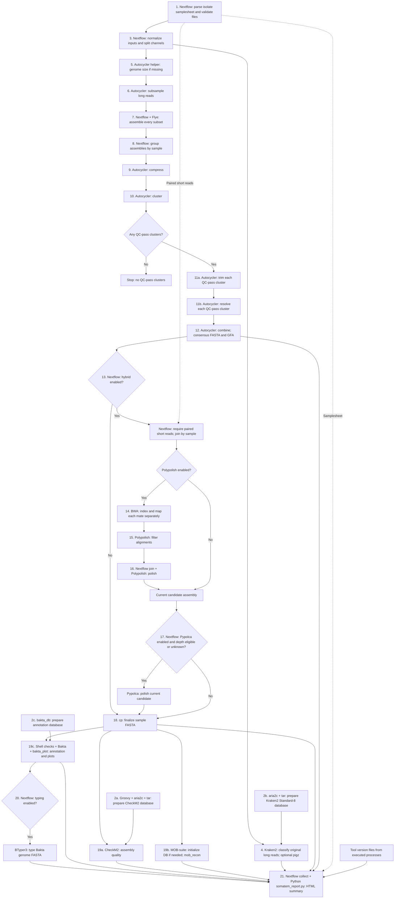

**Defaults and branch details.** [Current configuration](../nextflow.config) selects four Autocycler subsets, Flye as the only implemented assembler, hybrid polishing off, Polypolish and Pypolca enabled within the hybrid branch, and optional BTyper3 off. Bakta's isolate defaults skip small-ORF searching through [module configuration](../conf/modules.config). Kraken2 saves read assignments but not classified/unclassified FASTQs by default. The normal route is therefore long reads → Autocycler/Flye consensus → final FASTA → parallel quality/annotation/plasmid analysis, with read classification alongside assembly.

**Outputs.** Under `<outdir>/isolate_analysis/<sample>/`, the modules publish `autocycler/subsamples`, `autocycler/assemblies`, consensus data, `assembly`, `classification/kraken2`, optional `polishing`, `quality/checkm2`, `plasmids`, `annotation/bakta`, and optional `typing/btyper3`. The cross-sample report is `<outdir>/summary_reports/isolate_analysis_summary_report.html`. Actual file presence depends on enabled branches and optional outputs.

**Source-observed limitations.**

- The standard CSV reader copies neither `shortread_depth`, `short_read_depth`, nor `illumina_depth` into metadata. Its Pypolca depth gate therefore normally sees unknown depth and allows the sample; it does not compute short-read coverage. Metadata supplied directly by another caller can activate the gate. [Parser](../subworkflows/local/utils_nfcore_somatem_pipeline/main.nf), [gate](../subworkflows/local/isolate_analysis.nf).
- The isolate database route invokes the fixed Standard-8 download process even when `kraken2_db` is configured; the custom-database selection is implemented in the taxonomic-profiling route only. CheckM2 and Bakta download processes are also invoked by this route; resume/caching behavior is separate from that source-level fact. [Database routing](../subworkflows/local/download_databases.nf).
- The settings named `assembler`, `autocycler_assemblers`, and `shortread_mapper` do not switch implementations in this traced workflow: it calls Flye and BWA directly. The `species` input is passed through assembly inputs but is not used by the called assembly commands. [Workflow](../subworkflows/local/isolate_analysis.nf), [Flye module](../modules/local/flye/autocycler/main.nf).
- Empty Bakta placeholder outputs are permitted, so an emitted filename alone does not establish successful annotation plotting or populated content. [Bakta module](../modules/local/bakta/bakta/main.nf).
- These are static source observations. The pipeline and external scientific tools were not executed; internal algorithms within those external tools are outside this trace.

## SeqScreen

`somatem seqscreen` takes one FASTA per sample and an existing SeqScreen database directory. It bypasses shared read preprocessing and automatic database downloads. The default mode is `fast`; windowing and HMM scanning are off. The active route is the modular `SEQSCREEN_DSL2` workflow, not the older single-command `SEQSCREEN` wrapper used by a developer test.

| Step | Tool / process | Behavior and output |
|---|---|---|
| Q1 | Nextflow CSV and tuple validation | Require sample ID and one existing FASTA per sample; validate mode and the database directory. |
| Q2 | Python `validate_fasta.py` | Validate FASTA; expose a validated FASTA symlink and log. |
| Q3, optional | Python `split_window_input.py` | Split sequences into overlapping windows when enabled; otherwise retain the validated FASTA. |
| Q4a and Q4b | Bowtie2 | Independently align against the BSAT and VFDB nucleotide reference sets; emit two SAM streams. |
| Q5a and Q5b | RAPSearch2 (`rapsearch`) | Independently search the corresponding protein reference sets; emit two M8 streams. |
| Q6a and Q6b | Nextflow sample-ID joins; Python `threats_by_blacklist.py` | Combine the nucleotide/protein results for each reference set into screening-result files. These feed reporting. |
| Q7, optional | Easel `esl-translate` → HMMER `hmmscan` | Translate sequences and scan Pfam; emit the `pfam_hmm` directory. This is a side branch with no report-input edge. |
| Q8f, fast only | DIAMOND `blastx`, run twice | Produce tabular and XML protein-search output plus functional-input symlinks. If XML generation fails, write an empty XML file and retain the tabular results. |
| Q9f, fast only | Centrifuge | Produce nucleotide-based classification results in parallel with DIAMOND. |
| Q10f, fast only | Python `consolidatedtax_2_taxreport_fast.py` | Join DIAMOND tabular results and Centrifuge results by sample; produce `taxonomic_results.txt`. |
| Q8s, sensitive only | BLASTN, two instances | Search NT and MEGARes independently. NT feeds outlier processing; MEGARes results are not connected to downstream reporting in this workflow. |
| Q9s, sensitive only | MUMmer | Compare against the configured REBASE reference; emit results on a side branch with no downstream report-input edge. |
| Q10s, sensitive only | BLASTX → `blast_formatter` | Search the configured protein reference, convert the archive into XML and tabular output, and create functional-input symlinks. |
| Q11s, sensitive only | `sort` → Python `score_blast.py` → `remove_outliers.py` | Score/filter NT matches and produce a cleaned BLAST table plus an outlier report. |
| Q12s, sensitive only | Python `btab_2_tax_report_sensitive.py` | Combine BLASTX and cleaned NT results into `taxonomic_results.txt`. |
| Q13 | Python `functional_report_generation.py` | Use FASTA, the chosen protein-search table, and annotation resources to produce `functional_results.txt`. This branch does not wait for taxonomic assignment. |
| Q14 | Nextflow sample-ID joins; Python `seqscreen_tsv_report.py` | Combine taxonomy, function, both screening-result sets, input FASTA and database lookups into `seqscreen_report.tsv`. |
| Q15 | Python `generateHtmlReport.py` | Combine TSV, input FASTA, protein-search XML and local templates/assets into portable `seqscreen_report.html`. |
| Q16 | Python `reference_inference_short_read.py` | After the TSV exists, use taxonomy and FASTA to perform the reference-validation substeps below. Runs alongside HTML generation. The TSV is staged but is not passed as an argument to this script. |
| Q17 | Shell copies → Python `format.py` → shell/Nextflow publication | Gather TSV, HTML, taxonomy, function and reference-inference directory; apply configured final report formatting; copy the result layout to the output directory. |
| Q18 | Nextflow/nf-core version collation | Emit final outputs and versions; the main pipeline collects report/taxonomy/function as key outputs. HTML is published by the format module but is not added to the main `summary_reports` channel. |

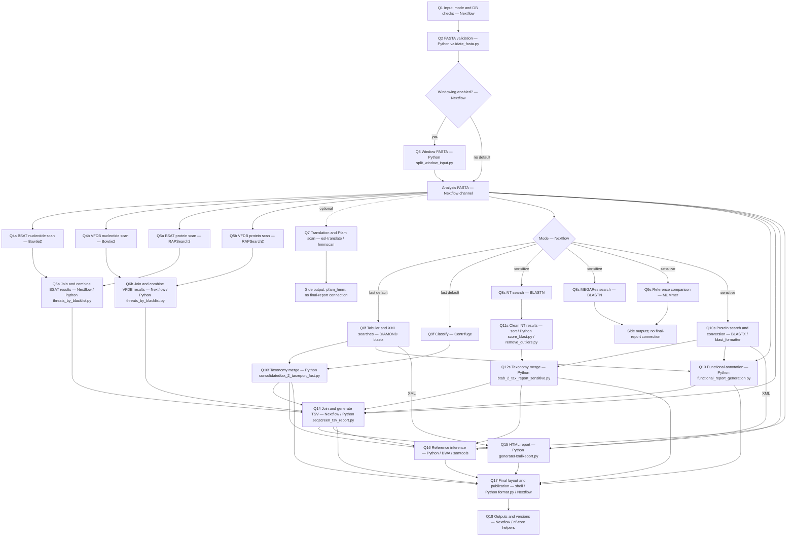

The reference-inference helper adds these internal steps:

| Step | Tool | Behavior |
|---|---|---|
| R1 | Python / ETE3 taxonomy | Select candidate taxa from the taxonomy output. Exit successfully if there are none. |
| R2 | Python local-reference lookup, or NCBI `datasets` + `unzip` | Prepare references from local database resources by default; use the online retrieval branch only when enabled. Exit successfully if no references are available. |
| R3 | BWA `index` and `mem` | Map the input against each prepared reference. The script contains a minimap2 helper, but `main` calls BWA. |
| R4 | samtools `view`, `sort`, `index`, `depth`, `stats`; Python | Prepare alignments, calculate coverage and summarize reference support. |
| R5 | Python | Select supported references and concatenate their sequences; exit successfully if no references remain. |
| R6 | BWA → samtools | Remap against the merged reference and repeat filtering, sorting, indexing, depth and coverage calculations. |
| R7 | samtools `consensus`; Python | Generate consensus, calculate identity/support summaries and write presence/absence results to `alignment.csv`. |

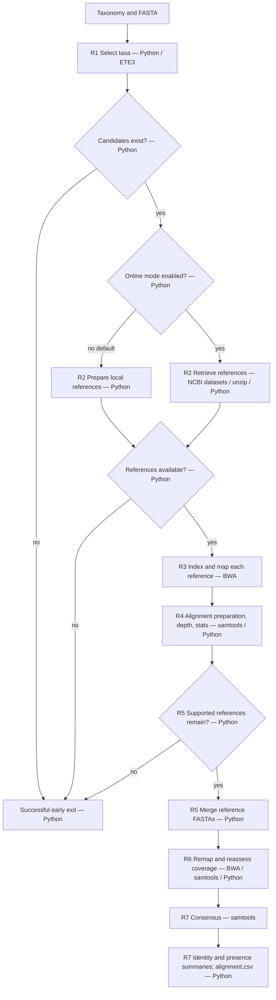

**Wiring limits:** HMMER, MEGARes and MUMmer results are not passed to the final formatter and have no explicit publication directive in their modules; their version records are collected. Reference inference writes most intermediate files into `inference_working`, which its module does not emit. The formatter publishes sample-independent filenames into a common output root, so multiple samples can collide there; this is a source-level risk, not an observed runtime failure.

Sources: [SeqScreen workflow](../subworkflows/local/seqscreen.nf), [validation](../modules/local/seqscreen/validate_fasta/main.nf), [windowing](../modules/local/seqscreen/window_fasta/main.nf), [Bowtie2](../modules/local/seqscreen/bowtie2/main.nf), [RAPSearch2](../modules/local/seqscreen/rapsearch2/main.nf), [screening merge](../modules/local/seqscreen/threats_by_blacklist/main.nf), [HMMER](../modules/local/seqscreen/hmmscan/main.nf), [DIAMOND](../modules/local/seqscreen/diamond_blastx/main.nf), [Centrifuge](../modules/local/seqscreen/centrifuge/main.nf), [BLASTN](../modules/local/seqscreen/blastn/main.nf), [BLASTX](../modules/local/seqscreen/blastx/main.nf), [MUMmer](../modules/local/seqscreen/mummer/main.nf), [outlier handling](../modules/local/seqscreen/outlier_detection/main.nf), [taxonomy assignment](../modules/local/seqscreen/taxonomic_assignment/main.nf), [function assignment](../modules/local/seqscreen/functional_assignment/main.nf), [TSV](../modules/local/seqscreen/report_tsv/main.nf), [HTML](../modules/local/seqscreen/report_html/main.nf), [reference module](../modules/local/seqscreen/reference_inference/main.nf), [reference helper](../assets/seqscreen/scripts/reference_inference_short_read.py), [formatter](../modules/local/seqscreen/format_report/main.nf).

## Genome dynamics

Entry: `somatem genome_dynamics` (alias `dynamics`) selects `analysis_type=genome-dynamics`. After per-sample preprocessing, it collects **all clean read files into one Rhea task** with synthetic metadata `id=multiple`. It does not run a separate Rhea task per input sample. Sources: [CLI](../bin/somatem), [genome-dynamics subworkflow](../subworkflows/local/genome-dynamics.nf), [orchestrator](../workflows/somatem.nf).

| Step | Tool / implementation | Behavior and result |
|---|---|---|
| 1 | Nextflow initialization | Parse the time-series samplesheet/read tuples. |
| 2 | **Deacon** + Nextflow, optional | Reuse/fetch the host index and deplete host reads if enabled. |
| 3 | **NanoPlot**, **zcat → Chopper → gzip**, **NanoPlot**, **Python** | Complete the shared preprocessing path: raw QC runs independently; filtered reads feed final QC and the preprocessing summary. |
| 4 | Nextflow `map → collect → flatten → map` | Discard per-sample metadata, gather all clean read paths, flatten them, and assign `[id: multiple, single_end: true]`. A `.view()` also prints this collected tuple. There is no explicit chronological sorting in this subworkflow. |
| 5 | **Rhea** (`RHEA`) | Invoke one external `rhea` process on the full read-path list. Declared outputs include the `metaflye` directory/GFA, Bandage metadata, base-pair counts, edge/node coverage, normalized coverage, logs, structural-variant TSV, and GAF files. |
| 6 | **Bandage image**, twice (`BANDAGE_IMAGE`) | Render the Rhea graph as PNG and SVG. The generic module also supports decompression via `zcat` and cleanup of the temporary uncompressed file for a gzipped GFA, although Rhea supplies an uncompressed GFA here. |
| 7 | **Python**, `somatem_report.py` (`GENOME_DYNAMICS_SUMMARY_REPORT`) | Collect graph, metrics, variants, alignments, log, images, versions, and samplesheet into `genome_dynamics_summary_report.html`. |
| 8 | Nextflow/nf-core helpers | Emit the GFA/PNG graph channel and summary, collate versions, and finish the run. The SVG participates in the summary inputs but is not added to the subworkflow's `assembly_graph` emit. |

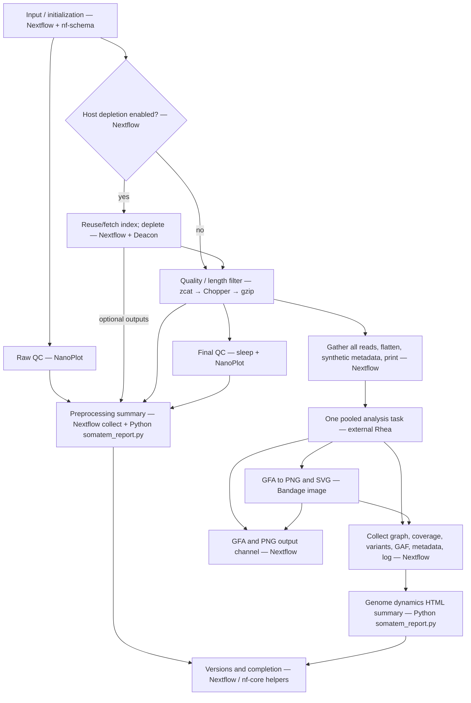

**Evidence boundary:** the repository wraps Rhea and declares Flye/minigraph in its Conda environment, but Rhea's internal implementation is fetched from an external Git branch. Its local wrapper does not establish the order or details of its internal assembly, graph mapping, or variant-analysis stages. Those remain opaque here; the output directory name `metaflye` alone is not proof of an internally observed execution trace. Rhea's version file records Flye's version, not Rhea's. Bandage publishes version information to a topic channel; this subworkflow does not mix it into `ch_versions`. Sources: [Rhea wrapper](../modules/local/rhea/main.nf), [Rhea environment](../modules/local/rhea/environment.yml), [Bandage wrapper](../modules/nf-core/bandage/image/main.nf), [summary module](../modules/local/somatem_summary_report/main.nf).

## Database preparation

`somatem pre_download_databases` (alias `dbs`) invokes `DOWNLOAD_DBS` directly. It prepares databases for the configured analysis/data type and profiler; it does not download every supported database. Its unmodified defaults select metagenomic Sylph profiling plus host depletion. The same subworkflow is reused by the main analysis routes.

| Step / branch | Tool | Behavior |
|---|---|---|
| D1 | Bash → Nextflow | Launch the standalone database entry with the repository configuration. No samplesheet is read. |
| D2, eligible host depletion | Nextflow path check or Deacon `index fetch` | Reuse an existing index path or fetch the configured host index. Excluded for isolate and SeqScreen. |
| D3a, 16S | OSF client → shell `mkdir`/`mv` | Fetch Emu sequence/taxonomy files, then stage a database directory. |
| D3b, Sylph | Nextflow path check or aria2c | Reuse the selected `.syldb` or download a supported standard group database. A missing custom or `all` database causes an error. |
| D3c, LEMUR/MAGNET | Groovy/Java HTTPS and JSON → aria2c → tar → shell staging | Read Zenodo metadata, verify download checksum, extract and stage LEMUR files. |
| D3d, Kraken2 taxonomy | Nextflow path check or aria2c → tar → shell file discovery | Reuse a custom existing database; otherwise acquire and normalize the Standard-8 database directory. |
| D3e, SingleM taxonomy | SingleM `data` → shell directory check | Obtain the metapackage and verify the expected directory. |
| D4a, assembly or isolate | Groovy/Java HTTPS and JSON → aria2c → tar → shell | Resolve CheckM2 release/checksum, download, extract and name the `.dmnd` database. |
| D4b, assembly or isolate | `bakta_db download` | Download Bakta; the module selects the light database unless its arguments explicitly choose a type. |
| D4c, assembly only | SingleM `data` → shell directory check | Obtain the SingleM metapackage. |
| D4d, isolate only | aria2c → tar → shell file discovery | Acquire Standard-8; this branch does not consult the custom Kraken2 database option. |
| D5 | Nextflow channels and configured `storeDir` | Expose applicable database paths and empty channels for unused types. Persistent output directories allow available outputs to be reused. There is no analysis report from this utility. |

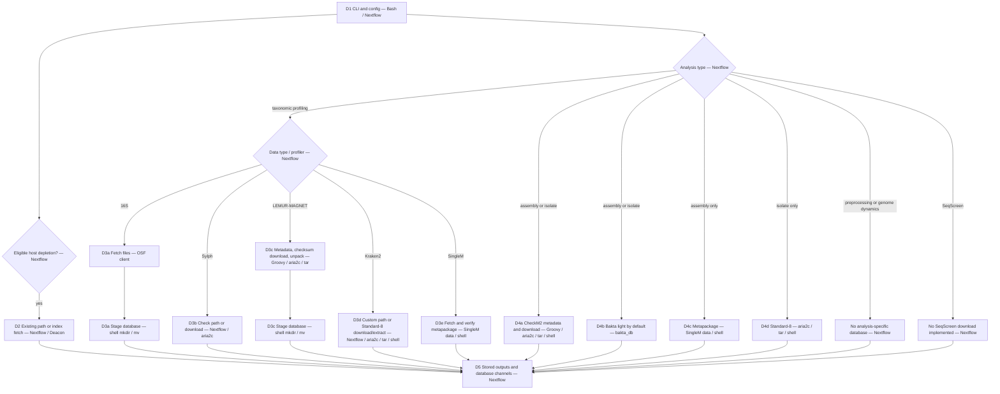

SeqScreen databases must already exist. MOB-suite initializes its own database inside isolate analysis when needed; it is not covered by this utility. The source default for `db_base_dir` is the installation's `assets/data/databases` unless `SOMATEM_DB_DIR` is set, which differs from the README's stated home-directory default. Bakta's README size warning also does not reflect the module's light-database default.

Sources: [standalone entry](../subworkflows/local/utils/pre_download_databases.nf), [database dispatcher](../subworkflows/local/download_databases.nf), [Deacon](../modules/local/deacon/fetch/main.nf), [Emu](../modules/local/emu/download_db/main.nf), [Sylph](../modules/local/sylph/download_db/main.nf), [LEMUR](../modules/local/lemur/download_db/main.nf), [Kraken2](../modules/local/kraken2/download_db/main.nf), [SingleM](../modules/local/singlem/download_db/main.nf), [CheckM2](../modules/nf-core/checkm2/databasedownload/main.nf), [Bakta](../modules/nf-core/bakta/baktadbdownload/main.nf), [persistent paths](../conf/modules.config), [MOB-suite](../modules/local/mob_suite/recon/main.nf).

## Example data download

`somatem download_example_data` (alias `examples`) uses a standalone Nextflow entry and then records the successful download location for later CLI examples.

| Step | Tool | Behavior |
|---|---|---|
| E1 | Bash / Nextflow | Resolve the destination, then invoke `DOWNLOAD_ZENODO_EXAMPLE_DATASETS`. |
| E2 | Python `download_zenodo_examples.py` | Iterate the six configured dataset archives: 16S, MAG assembly, isolate assembly, small metagenome, other tools and SeqScreen. Reuse an existing nonempty target directory. |
| E3 | Python `urllib.request` | Download each required archive from the configured Zenodo record. |
| E4 | Python `hashlib` | Compare downloaded archive MD5 against the checked-in expected value; fail on mismatch. Reused directories are not revalidated. |
| E5 | Python `zipfile` / `shutil` | Extract into a temporary directory, normalize a single enclosing directory if present, and copy into the dataset destination. |
| E6 | Python | Write six samplesheets with resolved data paths and the download manifest. |
| E7, failure fallback | gdown → Python → `find`/`sort` | If the primary helper fails, download the Google Drive folder, generate samplesheets in `samplesheets-only` mode, and create a file manifest. This branch does not run the Zenodo archive checksum checks. |
| E8 | Bash | After successful Nextflow completion, save the example location to the user's Somatem state file for later example-input selection. |

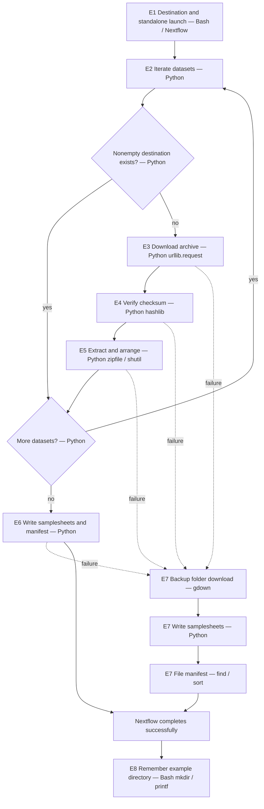

The active Python helper generates samplesheets, not configuration YAML files, despite the broader CLI help wording. Sources: [example workflow](../subworkflows/local/download_example_datasets.nf), [downloader](../bin/download_zenodo_examples.py), [launcher](../bin/somatem).

## Shared helper workflows

The launcher and analysis diagrams above cover `main.nf`, `ORCHESTRATE_SOMATEM`, `SOMATEM`, `PIPELINE_INITIALISATION`, and `PIPELINE_COMPLETION`. The remaining named helper workflows are:

| Helper | Steps and tools |
|---|---|
| `UTILS_NEXTFLOW_PIPELINE` | Groovy/Nextflow: optionally print version and exit; serialize parameters to JSON and copy them into `pipeline_info`; optionally invoke `conda config --show channels` and inspect channel ordering. |
| `UTILS_NFCORE_PIPELINE` | Groovy/Nextflow: inspect config/profile presence; warn about positional arguments; reject malformed profile syntax; emit config status. |
| `convert_to_nfcore_tuple` | Nextflow: interpret a path/glob; create file channels; attach `id` and `single_end` metadata; collect glob matches into a single tuple. Used mainly by developer harnesses. |

```mermaid
flowchart TD
    subgraph H1["UTILS_NEXTFLOW_PIPELINE"]
        HV{"Version-only request? — Groovy"} -->|yes| HE["Print version and exit — Groovy"]
        HV -->|no| HP["Optional parameter JSON save — Groovy / Nextflow file copy"]
        HP --> HC["Optional channel check — conda config / Groovy YAML parser"]
        HC --> HO["Emit helper completion — Nextflow"]
    end
    subgraph H2["UTILS_NFCORE_PIPELINE"]
        NC["Check config presence — Groovy"] --> NP["Check profiles and positional args — Groovy"]
        NP --> NO["Emit config status or error — Nextflow"]
    end
    subgraph H3["convert_to_nfcore_tuple"]
        CP["Input path — Nextflow"] --> CD{"Trailing slash? — Groovy"}
        CD -->|yes| CF["Create FASTQ directory channel — Nextflow fromPath / map"]
        CD -->|no| CG{"Contains wildcard? — Groovy"}
        CF --> CG
        CG -->|yes| CC["Collect matches; combine IDs and files — Nextflow"]
        CG -->|no| CS["Create path channel; attach metadata — Nextflow fromPath / map"]
        CC --> CO["Emit metadata/file tuple channel — Nextflow"]
        CS --> CO
    end
```

The directory test and wildcard test are separate `if` statements. For a trailing-slash path without a wildcard, the second test's `else` reassigns `tuple_out`; the intended directory FASTQ channel is overwritten. The diagram shows the actual fall-through. Sources: [Nextflow utility](../subworkflows/nf-core/utils_nextflow_pipeline/main.nf), [nf-core utility](../subworkflows/nf-core/utils_nfcore_pipeline/main.nf), [tuple helper](../subworkflows/local/utils/nf-core-compatibility.nf).

## Developer test workflows

These 15 standalone `.nf` harnesses are separate from the nine CLI commands. Each diagram below shows its active calls. Imported but commented-out tools are not active steps. They use fixed example paths and are not evidence that a test was executed successfully. Module-level `.nf.test` files are assertions/harness definitions, not additional user-facing analysis routes. No GitHub Actions workflow files were found under `.github/workflows` in this checkout.

| Harness | Active steps and tools | Important distinction |
|---|---|---|
| [agb_test.nf](../test-modules/agb_test.nf) | Nextflow wraps an assembly directory in metadata → `AGB` wrapper, Python/AGB | Passes empty graph/info channels; differs from production GFA/GV/info wiring. |
| [bandage_test.nf](../test-modules/bandage_test.nf) | Tuple helper for graph and color CSV → `BANDAGENG_IMAGE`, BandageNG | Production genome dynamics calls the separate Bandage module. |
| [centrifuger-test.nf](../test-modules/centrifuger-test.nf) | Nextflow read/database/thread channels → `centrifuger` | Centrifuger is a test-only alternative here; SeqScreen uses Centrifuge. |
| [chopper_test.nf](../test-modules/chopper_test.nf) | Tuple helper + empty contaminant reference → zcat/Chopper/gzip | No raw/final NanoPlot branch. |
| [deacon_test.nf](../test-modules/deacon_test.nf) | Tuple helper; Deacon index fetch → Deacon filter | Fetches the configured index directly. |
| [emu_test.nf](../test-modules/emu_test.nf) | OSF database download → attempted shell staging → Nextflow print | References nonexistent `emu_db_files`; module output is `db_files`. Emu abundance call is commented out. |
| [ensemble-test.nf](../test-modules/ensemble-test.nf) | Tuple helper → Ganon and Kraken2 in parallel | No ensemble reconciliation step is implemented in the harness. |
| [lemur-test.nf](../test-modules/lemur-test.nf) | Tuple helper; Zenodo metadata/aria2c/tar → shell staging → Nextflow print | LEMUR classification call is commented out; the reads channel is not consumed. |
| [magnet_test.nf](../test-modules/magnet_test.nf) | Tuple helper + existing classification file channel → MAGNET | Uses an existing report, not a LEMUR call. |
| [metagenomescope_test.nf](../test-modules/metagenomescope_test.nf) | Tuple helpers for graph/info → MetagenomeScope `mgsc` | Separate graph-viewer test; production assembly uses AGB. |
| [nanoplot_test.nf](../test-modules/nanoplot_test.nf) | Tuple helper → NanoPlot | One QC invocation. |
| [rhea_test.nf](../test-modules/rhea_test.nf) | Tuple helper collects FASTA glob → Rhea | Bypasses the main preprocessing route. |
| [seqscreen_test.nf](../test-modules/seqscreen_test.nf) | Tuple helper + database path channel → legacy `seqscreen` CLI | Does not exercise the modular `SEQSCREEN_DSL2` workflow. |
| [sylph-test.nf](../test-modules/sylph-test.nf) | Tuple helper + configured database → Sylph profile | No conversion, Taxburst, or summary step. |
| [template-module-test.nf](../test-modules/template-module-test.nf) | Tuple helper + database/taxonomy/rank channels → placeholder `TOOL` | Template module executes a placeholder command named `name`; not a working scientific workflow. |

Each disconnected subgraph is one harness; there are no dependencies between them.

```mermaid
flowchart TD
    subgraph AGBTEST["agb_test.nf"]
        AG0["Directory to metadata tuple — Nextflow"] --> AG1["AGB wrapper — Python run_agb.py / AGB"]
        AGE["Empty graph and info channels — Nextflow"] --> AG1
    end
    subgraph BANDTEST["bandage_test.nf"]
        BA0["Graph and CSV to tuples — Nextflow helper"] --> BA1["Render graph — BandageNG"]
    end
    subgraph CENTTEST["centrifuger-test.nf"]
        CE0["Reads, DB, threads — Nextflow channels"] --> CE1["Classify — Centrifuger"]
    end
    subgraph CHOPTEST["chopper_test.nf"]
        CH0["Read tuple and empty contaminant reference — Nextflow"] --> CH1["Filter — zcat / Chopper / gzip"]
    end
    subgraph DEACTEST["deacon_test.nf"]
        DE0["Read tuple — Nextflow helper"] --> DE2["Deplete host — Deacon filter"]
        DE1["Fetch index — Deacon"] --> DE2
    end
```

```mermaid
flowchart TD
    subgraph EMUTEST["emu_test.nf"]
        EM0["Download reference files — OSF client"] --> EM1["Invalid output reference: emu_db_files — Nextflow"]
        EM1 -. intended but broken connection .-> EM2["Stage directory — shell mkdir / mv"]
        EM2 --> EM3["Print database directory — Nextflow view"]
    end
    subgraph ENSTEST["ensemble-test.nf"]
        EN0["Read tuple — Nextflow helper"] --> EN1["Classify — Ganon"]
        EN0 --> EN2["Classify — Kraken2"]
    end
    subgraph LEMTEST["lemur-test.nf"]
        LE0["Read tuple, unused — Nextflow helper"]
        LE1["Metadata and database download — Groovy / aria2c / tar"] --> LE2["Stage directory — shell mkdir / mv"]
        LE2 --> LE3["Print database directory — Nextflow view"]
    end
    subgraph MAGTEST["magnet_test.nf"]
        MA0["Read tuple — Nextflow helper"] --> MA2["Refine existing classification — MAGNET"]
        MA1["Existing report path — Nextflow channel"] --> MA2
    end
    subgraph MGSTEST["metagenomescope_test.nf"]
        MG0["Graph and info tuples — Nextflow helper"] --> MG1["Build viewer — MetagenomeScope mgsc"]
    end
```

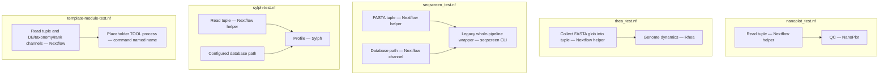

Additional tool evidence: [BandageNG](../modules/local/bandageng/image/main.nf), [Centrifuger](../modules/local/centrifuger/main.nf), [Ganon](../modules/nf-core/ganon/classify/main.nf), [MetagenomeScope](../modules/local/metagenomescope/main.nf), [legacy SeqScreen](../modules/local/seqscreen/main.nf), [placeholder tool](../modules/local/module_template.nf).

## Coverage and evidence limits

All nine CLI workflow commands, all named workflow declarations in `main.nf`, `workflows/` and `subworkflows/`, and all 15 standalone developer harnesses in `test-modules/` are represented above. Called local orchestration scripts are expanded where they add distinct tool stages. Version logging and routine temporary-file operations are grouped with their owning process.

External program internals, actual task scheduling, database availability, and successful end-to-end execution remain unverified. In particular, Rhea and MAGNET internals cannot be reconstructed from their invocation wrappers alone. The findings about missing channel edges, output paths and option mismatches describe source behavior or explicitly identified risks; they are not runtime failure reports.
